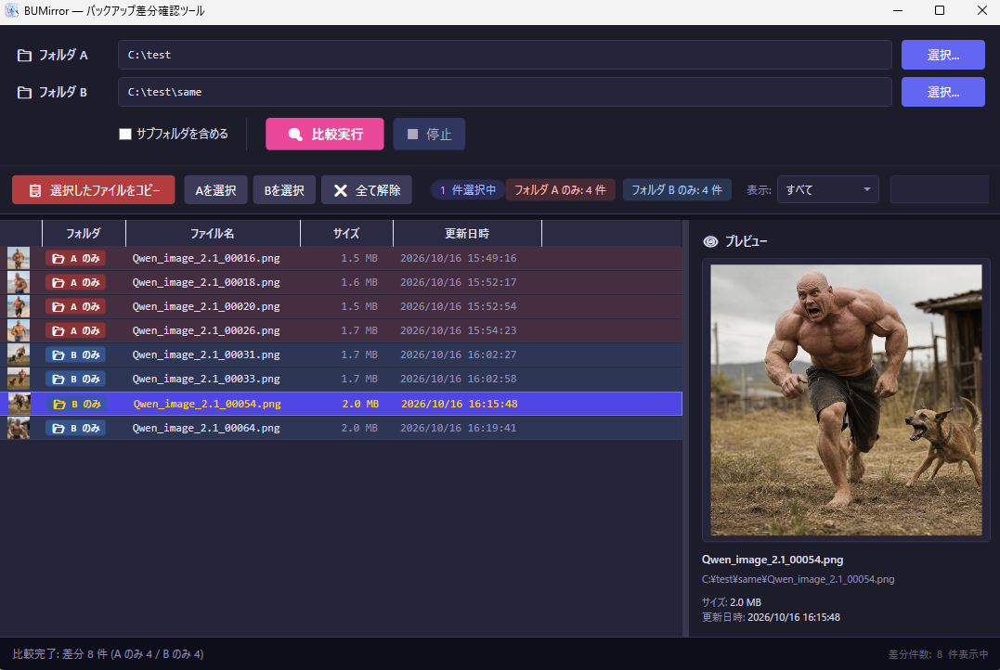

# BUMirror(バックアップ確認ツール)

[](https://opensource.org/licenses/MIT)
[](https://dotnet.microsoft.com/download/dotnet/8.0)

**BUMirror** は、2つのフォルダの内容を比較し、片方にしか存在しないファイル（バックアップ漏れや新規ファイル）を洗い出して、もう片方のフォルダへコピーするための Windows デスクトップツールです。

フォルダ間の差分をサムネイル付きの一覧で視覚的に確認しながら、不足しているファイルを正しい階層へ同期する作業を効率化します。


## 🚀 主な機能

### フォルダ比較
- 2つのフォルダ（**フォルダ A** / **フォルダ B**）をスキャンし、**片方にしか存在しないファイル**を差分として抽出します。
- サブフォルダを含めた階層構造全体の比較に対応（オプションで切替可能）。

### サムネイル / プレビュー
- 一覧左側に、画像・動画・各種ファイルのサムネイル／アイコンを表示します。
- 右側のプレビューペインには、選択中のファイルの**大きなプレビュー**（画像・動画）と、ファイル名・フルパス・サイズ・更新日時を表示します。

### 選択とフィルタ
- 個別クリック、Ctrl / Shift、マウスドラッグによる範囲選択に対応。
- **Aを選択** / **Bを選択** / **全て解除** ボタンで、片側のファイルをまとめて選択できます。
- 表示フィルタ： **A のみ** / **B のみ** の表示に切り替えることも可能です。
- キーワード検索：ファイル名を検索、フィルター出来ます。カンマ区切りの OR検索です。（例: `jpg, txt`）。

### コピー（ミラーリング）
- 選択したファイルを、もう一方のフォルダの**対応するディレクトリ構造**へまとめてコピーします。
- 進捗バーで進行状況を表示し、**停止**ボタンで途中キャンセルできます。

### ファイル操作
- **名前の変更**（`F2` または右クリックメニュー）。
- **削除**（`Delete` キーまたは右クリックメニュー）。複数選択時はまとめて削除でき、実行前に確認ダイアログを表示します。
- **場所を開く**（右クリックメニュー）でエクスプローラーを起動。
- ダブルクリックで既定のアプリによりファイルを開きます。

## 📋 動作要件

* **OS**: Windows 10 / 11 (64bit)
* **ランタイム**: [.NET 8.0 Desktop Runtime](https://dotnet.microsoft.com/download/dotnet/8.0)

## 🛠 使い方

1. 比較する 2 つのフォルダ（フォルダ A / フォルダ B）を選択、またはテキストボックスへドラッグ＆ドロップします。
2. **🔍 比較実行** ボタンで差分をスキャンします。
3. 一覧からコピーしたいファイルを選択します（フィルタや **Aを選択** / **Bを選択** が便利です）。
4. **📋 選択したファイルをコピー** ボタンで同期を実行します。

### ⌨️ 主な操作

| 操作 | 説明 |
| --- | --- |
| ダブルクリック | ファイルを開く |
| `F2` | 名前の変更 |
| `Delete` | 選択項目を削除 |
| 右クリック | 場所を開く / 名前の変更 / 削除 |
| Ctrl / Shift + クリック | 複数選択 |
| ドラッグ | 範囲選択 |

## 📦 インストール / 開発

### インストール方法

1. 以下のリンクから最新の `BUMirror.zip` をダウンロードします。

   [BUMirror.zip をダウンロード](https://github.com/OtabiHirohito/BUMirror/releases)

2. ダウンロードした ZIP ファイルを任意の場所に展開します。
3. 展開したフォルダー内の `BUMirror.exe` を実行します。

### ビルド方法

1. [Visual Studio 2022](https://visualstudio.microsoft.com/ja/vs/) または [.NET 8 SDK](https://dotnet.microsoft.com/download/dotnet/8.0) をインストールします。
2. リポジトリをクローンします。

   ```bash
   git clone https://github.com/OtabiHirohito/BUMirror.git
   ```

3. ソリューションファイル `BUMirror.sln` を開いてビルドするか、コマンドラインで以下を実行します。

   ```bash
   dotnet build
   ```

## 🤝 寄付について

   このソフトを気に入っていただけた場合は、よろしければ以下の寄付先への支援をご検討ください。
<sub>本ソフトおよび制作者はリンク先の組織とは一切関係がございません。</sub>

* [寄付先一覧](https://otabihirohito.github.io/DonationDirectory/)
* [ランダム寄付先](https://otabihirohito.github.io/DonationDirectory/random.html)

## 📄 ライセンス

  このプロジェクトは **MITライセンス** のもとで公開されています。詳細は [LICENSE.txt](LICENSE.txt) をご覧ください。

  ---

  Created by 大度寛仁 / X (Twitter): [@OtabiHirohito](https://x.com/OtabiHirohito)
